  <picture>
    <source media="(prefers-reduced-motion: reduce) and (prefers-color-scheme: dark)" srcset="./assets/blueprint-static.svg">
    <source media="(prefers-reduced-motion: reduce)" srcset="./assets/blueprint-light-static.svg">
    <source media="(prefers-color-scheme: dark)" srcset="./assets/blueprint.svg">
    <source media="(prefers-color-scheme: light)" srcset="./assets/blueprint-light.svg">
    
  </picture>

